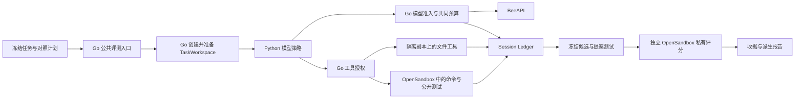

# Agent 对照实验与优先修复

范围：[规格 #36](https://github.com/huadeng408/CodeOps-Agent/issues/36)，
子任务 #37–#41。用户已批准三组小规模真实实验、同模型内部对照、两个高层测试边界，
并明确要求优先修复明显 bug 和可优化模块。完整发布仍按原七条 lane 单独验收。

## 当前状态

2026-11-01 两次续行已完成三项修复及新鲜 Go 回归。当前正式及补充计划累计 41 格、
实际尝试 30 格、评分通过 7 格、已尝试未知 23 格、历史未运行 11 格；另列本次四次技术诊断。
最新五次请求均为 HTTP 502，全部安全收尾并回读 Ledger；详情见文末两次续行记录。

工程状态为 `IMPLEMENTED`，Go／Python 回归及 Standards／Spec 审查已完成。
真实产品首试独立检查 11/11 通过；Context 四臂共 8 次尝试，7 次评分通过、
1 次提供方调用未知。预算、真实故障恢复和五轮需求变更的必需真实证据仍为 `BLOCKED`。
本文分别记录工程验证与产品结果，不将集成夹具升级为真实模型或完整发布证据。

用户要求账单检查由本人处理。本轮不再查询、核对提供方账单；
仅保留实验自动产生的用量、耗时和原始未知预留，货币费用保持 unknown。

## 生产执行边界与最大推理配置

正式对照使用 `runtime_contract=production_opensandbox`，复用产品的 Go TaskWorkspaces、
模型 Gateway、工具授权和 OpenSandbox runner。原有文件入口成功只作为入口证据，
不能替代这一契约。

文件操作仍由 Go 在受约束的实际副本上执行；Python 不直接执行文件或 Shell 副作用。
命令、提案测试及隐藏评分复用批准的 Docker-backed OpenSandbox Go profile，
不是另建普通 Docker runner。隐藏检查不进入 Agent 工作区、prompt 或普通收据。
同一个根任务的主 Agent、子 Agent、重试和反思共享 Go 预算。

当前最大推理输入为 `grok-4.6`、`reasoning_effort=xhigh`、500,000 上下文窗口、
368,928 输入上限和 131,072 输出预留；所有模型用途都经同一 Gateway。
输出预留是本次配置，不是对上游模型最大输出规格的声明。
Go 对返回模型 ID 精确匹配，并使用固定 provider session；接口别名及会话路由粘性
都不能证明上游权重 revision，后者仍为 unknown。

## 新的真实生产首试

| run ID | 完整分母与已知结果 | 用量和验收边界 |
| --- | --- | --- |
| `production-inventory-source-v1` | 0/1，模型派发前工作区准入拒绝 | Python 启动在实际副本创建了 checkpoint/context 数据库；保留原 4 条 Session 事实与文件，未取得任务槽 |
| `production-inventory-source-v2` | 0/1，返回模型 ID 不符 | 1 次调用、9,471 token；严格拒绝，没有工具调用。原始失败收据及已知用量保留 |
| `production-inventory-source-v3` | 0/1，独立评分未完成 | 7 次调用、68,976 token；主 Run 完成，真实 OpenSandbox 公开验证与候选测试通过且已停止；隐藏评分前置路径比较拒绝，不能判定任务通过 |
| `production-inventory-source-v4` | 1/1，独立检查 11/11 通过 | 6 次调用、60,250 token、224.059 秒；提案与独立评分均有原生 Ledger 引用，评分 runtime 已停止 |

v3 的原生评分收据错误地把未落 intent 的前置拒绝称为 `grader_outcome_unknown`。
只读追溯确认：真实提案已 ready、测试 passed，问题是同一个 Windows 目录的 `/` 和 `\`
被当成不同路径。修复路径等价核验，并区分未派发前置错误与已有 intent 的执行未知；
原始收据、Session 与结果不改写，后续以新 run 验证。

生产准备还发现并修复 Harness-managed Python 启动创建第二套 checkpoint/context 数据库的问题。
真实副作用恢复补充验证实际 TaskWorkspace 路径及
`tool/dispatched < code/modified < tool/result` 的持久化顺序；历史 result-only 不伪造补写为成功。
这些修复的本地协议测试不替代其他真实矩阵。

v4 的来源 Session 为 `627150c5e2d64d988cdbe20bfebf847f`，
Trace ID 为 `6b008f8393989e58a41be94044d2372e`。
冻结 Memory 前缀在隐藏评分之前，事件 `3d7d3f0e67c90038cc924f50b22e2d67`、
checksum `31c476d761ce90fd9f730cbd1868b5baac103396900a8065c49935b0907c053b`。
只读审计确认来源成功读取仅涉及 AGENTS、库存数据、库存规则和库存输出，
没有读取 Context 目标发票答案。各实验新写入的经验不能扩大这份来源。

| 范围 | 当前证据 |
| --- | --- |
| Go 产品入口 | 实际 Python 编排器及本地 HTTP 的 OpenAI／Anthropic 协议夹具通过；真实生产首试 v4 通过，既有失败均保留 |
| Context／Memory | 四臂 × 两次重复，7 次评分通过、1 次提供方未知；4 个关闭组历史读取／注入均为 0，4 个开启组都读取同一冻结来源 |
| 预算策略 | 600k／1M 两档、single／verify_retry／真实只读 subagent 的 6 格计划已冻结；首格提供方异常，其余 5 格未运行，不能生成策略排名 |
| 进程恢复 | 7 格中无故障首格提供方异常，其余 6 格未运行；实际故障次数为 0，恢复率未定义；夹具跨进程测试单独通过 |
| 需求变更 | 同 Session 五轮、至少两次根压缩的计划已冻结；两次独立尝试均为 0/5 轮，没有压缩后行为通过的声明 |
| 报告 | 按独立 task 聚合配对重复及 2×2 主效应／交互；未知、未运行与真实失败分开，缺失价格不画作零 |

## 10月31日原始矩阵与不可改写的分母

主矩阵共 22 格，来自 4 个任务输入；重复执行和同一 Session 的轮次不增加独立任务数。

| 原始 run | 计划 | 实际尝试 | 评分通过 | 基础设施未知 | 未运行 |
| --- | ---: | ---: | ---: | ---: | ---: |
| `production-context-v1` | 8 | 8 | 7 | 1 | 0 |
| `production-budget-v2` | 6 | 1 | 0 | 1 | 5 |
| `production-recovery-v2` | 7 | 1 | 0 | 1 | 6 |
| `production-sequence-v2` | 1 | 1 | 0 | 1 | 0 |
| 主矩阵合计 | 22 | 11 | 7 | 4 | 11 |
| 补充 `production-sequence-v3` | 1 | 1 | 0 | 1 | 0 |

合计计划 23、尝试 12、已知评分结果 7、未知或未运行 16；
产品首试和早期预检另列，不加入这 23 格。
Context 小样本范围的 [#38](https://github.com/huadeng408/CodeOps-Agent/issues/38) 已关闭；
#36 与 #39–#41 保留未完成状态，相关证据与阻塞已写入 Issue 评论，原规格正文未改。
预算、恢复与序列 v2 均为 `provider_transient_unknown`，各自完成收尾并保留未知计量。
补充序列在同一请求模型和最大推理配置下返回 `grok-4.6`，
与冻结期望 `grok-4.6-build` 不符，按 `provider_model_identity_unconfirmed` 拒绝。
没有放宽模型匹配、关闭 thinking、改用直接模型脚本或补造结果。
网络失败后的预算、恢复及补充序列仅在各自命令使用既有代理；没有修改系统代理。

Context 的独立任务仅 1 个，计划完整四组配对 2 轮、实际完整 1 轮。
已有评分的七次全部通过，但这不构成 100% 全矩阵成功率，也不支持统计显著或普遍领先。
检索组预读 3 个候选文件，按需组预读 0 个；两组都保留工具权限和 Ledger 完整性。
开启组每次固定召回 1 条、3,431 字节的既有经验，关闭组禁用自动预召回和显式历史读取。

### 分类修复与源码绑定

旧 Context 最后一格原生错误是提供方未知，但旧分类器误标成 `agent_failure/false`。
公共入口三参数测试先复现失败，再以一行分类修复转绿；budget 分支仍先处理。
原 Context summary、predictions、原生 Receipt 和校验清单均不改写。
`context-classification-v2/` 仅派生最后一行的 status 和 success，
保留 error、用量、500,000 预留、head、收尾及全部成功行。
派生物是解释修正，不是一次新运行，报告本身也不提升 provenance 标签。

实际 Context 使用的 `production-freeze-v3` 源码 ZIP SHA-256 为
`e727394eb0f72e3bf0eec803f65c5d94c9ae745122273fbdf5dbe66997940a46`；
后续 v2 计划使用 `production-freeze-v4`，ZIP 为
`9bab40eb4a6c8e7ac5407818bde8c5da16d7cdddd83147330360bc1607c3ed7e`。
二进制均为 `34fd418f4d5f1760501d54508afbd1484960670fe7ed592b07ba17834162fa2f`。
严格等价审计逐字核对两个 ZIP：各有 1,202 个源码文件和 1 个额外 patch；
源码集合仅分类器和对应测试不同，其他 1,200 个文件及额外 patch 相同。
Go 二进制、环境、operator settings 和两个冻结入口也相同。
显式 manifest SHA-256 为 `eeaa3fa55983756311931f3e2366c54984be0a3a8df7d44503ee024c1c7c15b9`。
这是指定两份快照的窄范围核验，不是对任意源码变化的收据继承豁免。
原来仅计划未派发的 budget／recovery／sequence v1 共 14 格也保留，
只由新 run ID 的 v2 计划替代，没有把未运行计划计成模型尝试。

## 原始首试

初始任务均为独立 Git 工作区中的受控文件修改，隐藏检查在工作区外。
四次首试各计划并尝试 1 项，共 4 项、成功 0 项；没有新增模型 reservation 或 dispatch。
费用保持 unknown，不把缺少用量等同于零费用。

| run ID | 结果 | 留存的具体原因 |
| --- | --- | --- |
| `pilot37-v1` | FAIL，0/1 | 模型派发前失败；当时未保留具体类别，不能事后改写原因 |
| `pilot37-v2` | BLOCKED，0/1 | 编排器启动阶段未就绪；`orchestrator_startup_unavailable` |
| `pilot37-v3` | BLOCKED，0/1 | 编排器已就绪，模型派发前失败；当时上层覆盖了具体 Done 类别 |
| `pilot37-v4` | BLOCKED，0/1 | 修复错误传递后明确为 `code_task_busy`，由既有任务占位触发 |

原始产物位于 `.runtime/eval/agent-experiments/artifacts/<run ID>/`。
各次源码压缩包、二进制与原始收据独立保留；不覆盖失败再重跑相同 run ID。

## 原任务准入占位与已批准的让出

只读复投影纠正了准备阶段的判断：没有活动模型调用，不等于没有任务占位。
原 #27 的最新 run 租约已经过期、没有终态，仍持有全局单任务槽。
它的原 200 项范围、Session、checkpoint 与运行事实不应改作新实验结果。

新增的 Go `YieldTask` 只让出调度占位，保留原任务继续申请同一批次的能力。
Go 检查 owner、根任务、过期或终态 run、工具／子任务／应用／runtime、活动模型调用及 scope；
任一检查不明确则拒绝。它仍保留全局单任务与调用防重边界。

用户审阅并明确批准了兼容性代价：新的 `admission/task_yielded` 需要新版 Ledger reader；
旧冻结二进制不能直接继续读取，后续不能直接续接旧源码的正式验收。
原始数据保留，不将历史验收自动升级。

真实只读预检和启用分别记录在：

- `.runtime/eval/agent-experiments/artifacts/task-yield-review-v1/`
- `.runtime/eval/agent-experiments/artifacts/task-yield-activation-v1/`

两次命令退出码均为 0。启用前后原 Session 均为 1,640 条事件，
head 为 `347e4b7f28aeedc6c2bd792f2a45977dd6892bd7e134171da08ec10a14408c3d`。
准入流只追加一次让出事实，已确认累计用量仍为 97,250,088 token；
历史未知计量及原始预留保留，活动调用为 0，未发起模型请求。
这些数字不是服务商余额或货币账单。

## 已发现问题与修复边界

- 启动失败与模型前置错误原先缺少安全诊断：现在传递固定阶段、标准 gRPC 类别及已知 Done 原因，不输出异常原文。
- pre-session 拒绝收据原先被 wrapper 的身份校验再次覆盖：现在严格校验已知字段并保留拒绝原因。
- 任意历史 evaluation Session 可穿过 Frozen Memory 引用范围：现在 catalog 的来源必须闭合，当前任务只提供经验证的创建元数据。
- 超时可能只终止 Go 父进程：Windows 使用专属 Job，POSIX 使用专属进程组，验证范围分别记录。
- JSON 的布尔／数字判等、报告分母矛盾、失败后的指纹校验、工作区准备失败收尾及证据标签 preflight 均已进入独立审查修复，不带着这些问题生成结论。
- 共同预算在 reservation 的同一次 CAS 内核对，覆盖根任务、真实子任务、反思和失败调用，修复并发预留突破 trial 上限的问题。
- Go 强制公开验证最多两次：首轮已通过就关闭候选；首轮失败仅开放一次修复阶段，禁止第三次验证、平行绕过及晚到写入。
- Harness-managed Python 只用已有进程内投影，不再在实际工作区创建另一套 Memory／checkpoint 事实库。
- 独立评分区分未派发前置错误、已知 runtime 拒绝与结果未知，不把 transport 错误伪装成 exit 126，也不盲目重投已有评分 intent。
- 慢评分夹具先发送并刷新响应头，再执行评分；真实公共路径以 11 秒延迟复现并验证修复，未扩大产品超时。

## 10月31日验证与交付边界

| 命令／检查 | 结果与范围 |
| --- | --- |
| `go test -json ./... -count=1 -timeout=25m` | exit 0；47 包通过、13 无测试包跳过；2,065 个 test pass、86 个 skip；`verification-v4/go-test.ndjson` |
| `go vet ./...` | exit 0；`verification-v4/go-vet.log` |
| `python -m pytest -q` | exit 0；2,768 passed、18 skipped、31 warnings；1,758.61 秒；`verification-v3/pytest.log` |
| 分类修复公共入口定向回归 | 先 3 failed；修复后 7 passed／70.54 秒；原 Agent 失败及基础设施分支另 3 passed／23.87 秒，exit 0 |
| `python -m mypy --follow-imports=skip eval/experiments.py eval/experiment_report.py` | exit 0，仅两份目标模块；不代表全仓库类型检查 |
| 两份目标模块 `compileall` | exit 0 |
| 不限制 import 的补充 mypy | exit 1，目标模块之外 11 份依赖文件共 25 条类型错误；已记录，不宣称该范围通过 |
| Standards／Spec 独立审查 | 已关闭已发现问题，最终运行代码及分类补丁无未解决 P1／P2 |

Python 全量套件之后的 Python 改动仅为上述分类器和新增测试，已定向重验；
后续 Go 改动由新的完整 Go 套件覆盖。原完整 Go 首次失败仍保存在
`verification-v3/go-test.ndjson`，没有用后一次通过覆盖。
曾误扫含上游 benchmark 故意错误源码的整个 eval 运行树，不能作为有效语法检查；
后续只对目标模块检查，原有 benchmark 数据未清理。

原 #27 Session 最终只读检查仍为 1,640 事件、相同 head；未修改原 Session。
本轮启动的精确 OpenSandbox controller 已恢复原先 stopped 状态，未删除容器、volume 或工作区。
原始 run、冻结源码、输入重放包及派生审计位于忽略的本机实验树。
主交付入口为 `production-delivery-v1/README.md`，索引 `index.json` SHA-256 为
`c3ff67bf09c3b832efaedfa45ea9ad8076056aa48f0051769da1a16850580b16`。
该索引的 6 个产物目录校验清单与 36 个显式引用通过核验；它核验留存证据，
不冒充 canonical Ledger、提供方账户或 Trace 后端的在线核验。
真实矩阵尚未闭环，保留工程改动和可复现输入；不将 #36 或 #39–#41 标为完成。
按仓库验收后提交／推送的约定，当前未 stage、commit 或 push；候选 89 个文件完成
脱敏扫描，实际凭据字面量无命中，文件名造成的一项正则误报已独立记录并用 token 边界复核。
未涉及前端，不运行前端验收；完整发布七条 lane 仍独立为 `BLOCKED`。

本机 Trace 后端未完成读取验证。启动既有 Phoenix 的动作被自动审批以
`blocked by policy` 拒绝，工具未提供更具体原因；没有绕过该拒绝。
生成 Trace ID 不等于后端已核验。另一次删除单个临时审查目录也被同样拒绝，
该目录保留，没有换命令绕过。

## 11月1日续行：调度修复、安全诊断与真实请求

用户要求继续直至五张票全部完成，原来的真实闭环验收不缩小。
本次没有读取提供方账单或核对费用；货币费用继续 unknown。

### 优先修复

1. Python runner 原先在一次提供方暂时性失败已安全结束后仍停止整个批次。
   现在仅在 transient／timeout／transport 错误、准入已 finalize 且最终 Ledger 回读确认时，
   继续下一独立格。cleanup、评分未知、pin、身份、鉴权及其他 HTTP 错误仍停止。
   公共入口先 2 failed／1 passed，修复后连同原有停止条件共 9 passed，exit 0。
2. Go Gateway 原先只保留通用 5xx 类别，缺少可用的上游状态诊断。
   现在 stderr 只记录 HTTP 状态及固定白名单 type／code／param；不记录原始 message、
   body、header 或请求，标签即使等于实际 key 也会被屏蔽。
   公开 Gateway 四个参数用例先失败，再转绿；完整 admission 包通过，44.109 秒。
   原错误码、重试、空 payload 与未知预留语义不变，没有新增 Ledger 事件或第二个事实源。

两轮 Standards／Spec 增量审查均无未解决 P1／P2。
冻结 v6 继承的差异清单漏列调度器和对应测试，已在独立
`production-freeze-v6-correction-v1/metadata-correction.json` 中逐字核验并更正为四个路径；
原 manifest、源码 ZIP 与 checksum 保持不变。此项审查发现已关闭。

### 新尝试及模型配置边界

| run | 计划／尝试 | 实际结果 |
| --- | --- | --- |
| `production-sequence-v4` | 1／1 | `.dev` 旧 build 期望；提供方未知，0/5 轮 |
| `production-sequence-v5` | 1／1 | 新 `.ai`／精确 base profile；提供方未知，0/5 轮 |
| `production-budget-v4` | 6／6 | 全部提供方未知；新调度已使后续独立格实际进入请求，没有 child／修复／评分结果 |
| `production-recovery-v4` | 7／7 | 全部提供方未知；没有到达工具故障窗口，实际中断 0 次 |
| `production-sequence-v6` | 1／1 | 新诊断二进制，捕获 HTTP 502；安全标签均 unknown，0/5 轮 |
| `production-sequence-v7` | 1／1 | 去掉显式进程 HTTP 代理后捕获 HTTP 503；0/5 轮 |

本日新增 17 次均保留原始失败、未知预留和终态回读，安全收尾为 17/17；
这不是任务成功率或工具副作用恢复率。工具故障数仍为 0，恢复率未定义。
模型目录可列出 `grok-4.6`，但不能据此推断完成接口可用或上游权重固定。
当前安全诊断只能确认 HTTP 502／503，具体上游原因尚未取得。

新批次单独冻结 `.ai` 入口、请求及精确期望返回 `grok-4.6`、新的 provider session；
旧 build profile 不重解释或跨 profile 池化。所有请求配置继续为 xhigh、500k 上下文、
输入 368,928、输出预留 131,072；没有关闭 thinking、缩小配置或使用直接模型 fallback。
代理变化只作用于单个进程，系统代理与系统路由未改，也不声称无显式代理就绕过了系统 TUN。
恢复 v4 与最后一个序列有并行主机回归活动，已单独记录，不作主机隔离的延迟比较。

冻结 v7／v8 的二进制 SHA-256 为
`6861f4dacc687ca3fed33e885a56ded63f83a64d769aabcba2a15862e0db4dbc`，
源码 ZIP 为 `e4f451bb61819a65e6f541dca5469e28bd966c595203ec31e7108e024e8ab1ea`。
v8 只变更进程网络路径记录，源码及二进制与 v7 相同。

### 新鲜回归及当前交付状态

| 检查 | 本轮结果 |
| --- | --- |
| `python -m pytest -q` | exit 0；2,773 passed、18 skipped、31 warnings，1,394.22 秒 |
| `go test -json ./... -count=1 -timeout=25m` | exit 0；47 包通过、13 无测试包跳过；2,070 test pass、86 skip |
| `go vet ./...` | exit 0 |
| 源码绑定 | Go 全量运行前后 source pin 相同；Python 全量之后仅追加 Go 诊断及其测试，394 份 Python／依赖／指令文件仍与已测源码相同 |
| 双轴审查 | Standards 0 个未解决 P1／P2；Spec 0 个未解决 P1／P2 |

本次没有重新运行之前已失败的无范围限制 mypy，也不将其 25 条依赖类型错误改记为通过。
原 #27 最终只读核验仍为 1,640 事件和相同 head；没有读取其计量作为账单检查。
本轮启动的精确 OpenSandbox controller 已恢复原先停止状态，停止前没有活跃 task／egress 成员，
没有删除容器、volume、索引或工作区。

新交付入口 `production-delivery-v2/README.md` 保留所有 40 格正式与补充运行，
另列 27 格从未派发的替代计划及早期 13 次运行。派生图表按各自 cohort 展示，
不把它伪称为一份新共同预注册矩阵。原始运行和第一次交付均未改写。

#39 仍缺真实 child／验证修复与独立评分，#40 仍缺真实三窗口中断及五轮压缩后行为，
#41 仍缺上述验收和最终提交推送；三张票及父 #36 保持打开。需要取得可用的同模型渠道，
或失败请求的技术错误详情后，才能继续这些必需路径。当前代码保留在 main 工作区，未 stage／commit／push。

Computer Use 尝试读取已授权请求页的技术错误时，因为无法可靠核验当前 Windows 浏览器 URL
而自动结束；尚未进入请求页，也没有取得错误详情。没有改用其他浏览器操作绕过该停止。

## 11月1日第二次续行：数值错误码与请求最小化

用户再次要求继续，保持已批准的真实闭环、最高推理配置和“不检查账单”边界。
首先在冻结 v9 上新增正式 `production-sequence-v8`：原任务、运行二进制和模型配置不变，
仅注册新的 run ID，仍在首调用遇到 HTTP 502，0/5 轮。

随后将任务消息缩成一次简单确认，仍保留原模型、工具权限、xhigh、500k、输入 368928、
输出预留 131072 和 Go／OpenSandbox 边界。四次技术诊断使用同一个简化任务输入，
只作可用性排查，不加入正式任务质量或恢复率分母：

| 运行 | 本次变量 | 实际结果 |
| --- | --- | --- |
| `provider-diagnostic-minimal-v1` | 简化任务内容 | HTTP 502，未获得模型响应 |
| `provider-diagnostic-minimal-v2` | 数值错误码解析修复 | HTTP 502，安全标签仍 unknown |
| `provider-diagnostic-minimal-v3` | 仅增加显式进程本地代理 | HTTP 502，系统路由未改 |
| `provider-diagnostic-minimal-v4` | 仅更换 X-Trace-Id 标记 | HTTP 502；未证实提供方使用该标记选择渠道 |

五次新尝试均保留原始 unknown、准入 finalize 和最终 Ledger 回读；实际工具故障仍为 0。
正式与补充累计 41 格、尝试 30、评分通过 7、已尝试未知 23、历史未运行 11；
四次技术诊断、27 格未派发替代计划和早期 13 次运行分别单列，不池化。
启动脚本的 Windows 编码和相对路径预检错误均发生在模型派发前，修正后才执行同一新计划；
原始失败输出保留，不将它们误计成模型调用或额外任务。

本次确认的源码缺陷是 Go 诊断把 `error.type`／`code`／`param` 当整包字符串解析：
一个数字 `code` 会清空其他有效标签。新增公开 Gateway／HTTP／SQLite 用例先失败，
修复为逐字段解码后，数字字段继续 unknown，其他字段仍受原白名单和实际凭据屏蔽约束。
未改变模型请求、重试、错误分类、未知用量和预留；没有输出原始消息、请求、header 或 body。
这个修复没有使真实接口恢复，不能解释成已经查明 502 根因。

| 本次验证 | 结果 |
| --- | --- |
| 新数值码参数用例 RED | exit 1，仅 numeric_upstream_code 失败，包耗时 0.694 秒 |
| `go test ./internal/admission -count=1 -timeout=5m` | exit 0，44.416 秒 |
| `go test -json ./... -count=1 -timeout=25m` | exit 0，2071 test pass／86 skip，47 包通过／13 无测试包 |
| `go vet ./...` | exit 0 |
| Python 源码绑定 | 394 文件逐字相同，复用此前 2773 passed／18 skipped；本次未重跑 Python 全量 |
| 双轴增量审查 | Standards 0 findings／0 P1-P2；Spec 0 findings／0 P1-P2，仅覆盖冻结 v9 后两个文件 |

Go 全量运行前后 source pin 相同：dirty hash
`0d87654f4f1aa208c221aba69bbd2aafecb3f7a27e9e8b802119e179eee8af3f`；
记录见 `verification-v7/summary.json`，之后只有本说明文档更新。
新二进制 SHA-256 为 `d4204ead341875dfe94f9218146ec9e825e81475204f8d3778b794dc4576d62b`，
冻结 v10–v12 的源码 ZIP 为 `994ee4310c952f036102efe172dbf6d0fe4c423599d748ff670e5a62f24ff075`。
并行 Go 回归负载已记录，技术诊断不作主机隔离延迟比较。

本次启动的精确 controller 已恢复原先停止状态，停止前没有活跃 task／egress 成员；
未删除任何容器、volume 或业务数据。新附录为 `production-continuation-v3/README.md`，
旧收据、冻结树、图表及第一／第二版交付均未改写；更新口述稿另存 `interview-final-v2.md`。

本次浏览器可以访问授权请求 URL，但需要登录，已显示登录页并请用户接续；
没有取得请求技术错误详情，也没有向聊天发送凭据。缺少可用同模型服务或具体错误信息时，
#39、#40、#41 和父 #36 保持打开，未 stage／commit／push，不缩小其真实验收要求。

## 11月1日第三次续行：Go SSE 与 HTTP fixture 修复

本次新增 Go 所有的 opt-in SSE。Go 固定流式请求、完整组装文本／推理／工具参数，
校验完成标记、结束符、模型一致性和最终用量，再将一次完整 JSON 响应交给 Python。
默认 JSON 保持兼容；SSE evaluation binding 使用版本 2，旧读者拒绝继续该绑定。
没有改动 protobuf/gRPC、前端或唯一 Session Ledger 的边界。

独立审查发现并修复“中途 usage 可能被当成最终用量结算”的 P1：先保留公开 Gateway／
HTTP／SQLite 的失败用例，再让中途用量只参与单调性检查。没有完成事件同 chunk 或其后的
最终用量时仍保留 unknown 和原预留，不放行半个工具调用。17 份红绿日志及双轴审查封存于
`sse-review-v2/`；两个轴当前开放 P1/P2 均为 0，标记为 AI_REVIEWED。

五个新的 `provider-diagnostic-sse-v1` 至 `v5` 使用同一简化任务，单列为技术诊断：
v1 的失败没有固定状态类别日志；v2 记录 HTTP 200 的泛解析失败；v3 明确记录 HTTP 200 流内
`type=upstream_error`；v4 仅切换官方备用 `.dev` 域名，仍是相同类别；超过二十分钟后，
原 `.ai` profile 的 v5 返回 HTTP 403／`provider_authentication_unknown`，具体原因未知。
这些观测不能倒填旧运行的类别，不能把 HTTP 200 当模型任务成功，也不能由 403 推断账单问题。

五次均已安全 finalize 并验证最终 Ledger 回读，保留 unknown 和各自的 500000-token 原预留；
有效模型 completion、模型工具执行及实际工具故障均为 0。模型仍固定 grok-4.6、xhigh、
500k 上下文、输入 368928、输出预留 131072，thinking 开启，没有直接 Python fallback。
一次仅配置读取的 `GET /v1/models` 仍列出该模型，但没有提供可用的能力元数据；列出不等于可调用。
没有查询账户、余额或账单。原始响应观察命令被自动审批拒绝，未执行或换路重试；正常路径只记固定白名单类别。

正式及补充仍为 41 格计划、30 格尝试、7 格评分通过、23 格尝试未知、11 格未运行，四个正式任务输入。
技术诊断累计九次，一个简化任务输入；27 格未派发替代计划、早期 12 次预检及 1 份来源支持各自保留。
不跨任务、目的、源码和模型 profile 池化为共同对照，未新增策略收益、真实恢复率或多轮成功结论。

| 验证范围 | 本次结果 |
| --- | --- |
| `go test -json ./... -count=1 -timeout=25m` | exit 0；2104 test pass／86 skip，47 包通过／13 无测试包 |
| `go vet ./...` | exit 0 |
| Python 首轮全量 | exit 1；2772 passed／1 failed／18 skipped／31 warnings，1245.01 秒；失败原文保留 |
| Python 无 Go 回归并发的完整复跑 | exit 0；2773 passed／18 skipped／31 warnings，1137.24 秒；source pin 前后相同 |
| 全量后的单个 HTTP fixture 修复 | 本地未读请求体 4/300 失败，读完后 300/300 通过；修复该 fixture 后同文件 5 项通过，1.41 秒；生产源码、超时和断言未改，未再次重复全量 |
| 双轴增量审查 | SSE 及最后单个 fixture 两个范围分别审查，均为 0 个开放 P1/P2 |

HTTP fixture 的问题是响应前没有读完 POST 请求体；修复只在 `tests/eval/test_run_o3.py` 增加消费请求体，
不把本地测试失败和真实提供方错误混为同一原因。完整回归见 `verification-v8/summary.json`，
之后的单文件差异及运行内容绑定见 `verification-v9/summary.json`。此前未通过的无范围限制 mypy
不改记为通过；完整发布和 Trace 后端验收仍独立。

最新正常二进制 SHA-256 为 `9de8909f3b38aa73e99fe69636c26b5b94ed7b11c1c6831214b35f3ca8f7bc61`，
冻结 v16–v18 的源码 ZIP 为 `a0bd1eb171475b316f8ae3c02365c1dbd1ac9a0387c3476a5f5897a390ebba63`。
本轮拥有的精确 controller 已恢复原先停止状态，停止前 task／egress 活跃成员为 0，既有数据保留。
本次交付附录为 `production-continuation-v4/README.md`，口述稿和实际边界图另存 `interview-final-v3.md`；
旧原始收据、冻结树、图表和既有交付不改写。旧说明页的被引用字节仍保存在 v16 源码 ZIP，当前只追加本节。

Go 的受约束文件工具在专属 Task Workspace 执行，命令和独立最终评分走 OpenSandbox；
不能将全部文件工具都描述为容器内执行，也不能把沙箱准备成功说成模型已执行工具。
请求页仍需用户登录以取得失败条目的技术详情。#39／#40／#41 和父 #36 的真实必需验收未完成，
保持 OPEN，未 stage／commit／push；原 #27 和七条发布 lane 保留原范围。

## 11月2日续行：Docker 数据盘恢复与故障窗口证据修复

Docker 设置曾于 11 月 1 日 20:34 被重置到 C 盘默认数据目录，原 D 盘 VHDX 仍在。
本轮停止 Docker、备份小型设置文件后，仅恢复原 `CustomWslDistroDir` 并通过既有 helper 启动。
98 个镜像、47 个容器重新可见，原 OpenSandbox controller 和四个关键镜像 pin 匹配；
没有下载、批量构建、删除镜像或复制大磁盘，C 盘新 VHDX 保留。
安全启动快捷方式未改，脚本未发现写入数据目录设置的逻辑；触发重置的主体仍未知。
这是 daemon、资源可见性和 pin 核验，不是全部 volume 内容的完整性证明。

技术诊断新增 SSE v6–v10：v6/v7 为 HTTP 403，v8/v9/v10 分别于 22:06、22:34、23:50
收到 HTTP 200 流内 `rate_limit_error`。v10 是用户通知通道恢复后的正常 Go 产品复查，
仍没有有效 completion。五次均核验冻结输入、校验和、准入 finalize 和最终 Ledger 回读，
有效模型观测、模型工具执行和实际工具故障均为 0；各自原预留和 unknown 保留。
配置保持 grok-4.6／xhigh、500000 上下文、输入 368928、输出预留 131072、thinking 开启。
未查询账单、余额、账户或配额；技术诊断累计 14 次、一个简化输入，与正式对照分列。

本次优先修复三个已复现边界：JSON/SSE 推理用量核对及纯可见输出的区分；
文件工具 fixture 误触发宿主 Docker/WSL 探测；故障就绪信号被延迟消费后可能错过实际中断窗口。
最后一项先由公开进程用例复现：父进程延迟六秒，旧实现会在五秒审计上下文到期后放行 ACK。
现在保留原执行上下文，由 Go Ledger 持久化精确 ready/released 事实，绑定事件引用、run、tool、
进程身份和 deadline，释放必须先于后续效果或 ACK。新的故障 binding 为 3；无故障 JSON/SSE
绑定继续为 1/2，未改 gRPC 消息字段。

Python 将物理 kill 和 canonical 窗口证明分别保留，只有原进程确实停止、精确窗口仍被持有、
没有释放／终态／取消且在 deadline 前完成中断，才计入有效故障分母；证明不足保留 nullable unknown。
六秒延迟、原 Session 续行及过期／已释放／取消／终态／错误引用负例均有公开边界 fixture。
Standards 和 Spec 的修复审查各 0 个开放 P1/P2；原 Spec P2 和红绿失败历史保留，标记 AI_REVIEWED。
这些用例不替代真实提供方的三窗口恢复实验，也不建立一般 exactly-once 保证。

| 当前源码验证 | 结果 |
| --- | --- |
| `go test -json ./... -count=1 -timeout=30m` | exit 0；2161 test pass／86 skip，47 包通过／13 无测试包 |
| `go vet ./...` | exit 0 |
| `python -m pytest -q` | exit 0；2781 passed／18 skipped／31 warnings，1513.41 秒 |
| 两个评测 Python 模块 | 112 passed／1 skipped；限定两文件 mypy 和 compile/import exit 0 |
| `go build ... ./cmd/agent` | exit 0；校验和及完整命令见 verification-v13 |

全量前后 source pin 相同：dirty hash
`f0d6d31d43710e2e10caa6067ea7a33a3317edda429a10d4a0ce3291285cb303`，57 个未跟踪文件。
完整源码快照、日志、退出码和二进制见 `verification-v13/summary.json`；之后只追加本说明节，
对其余 1207 个冻结文件逐字核对。v10 的无终态、v11 的失败和 v12 的不可用 Docker context
压力失败仍各自封存，没有由本次成功覆盖。

正式及补充仍为 41 格计划、30 格尝试、7 格评分通过、23 格尝试未知、11 格未运行，四个正式任务输入。
本轮 controller 恢复原先停止状态，原 #27 的 1640 事件与 head 不变。源码提交与远端 SHA
另见 `source-delivery-binding-v1/summary.json`；提交只交付已验证的实现，不关闭缺少真实证据的票。
新增附录 `production-continuation-v5/README.md` 和口述 `interview-final-v5.md` 保留上述边界。
#39 仍缺真实 child／验证修复和多预算评分，#40 仍缺真实三窗口和五轮压缩后行为，
#41 与父 #36 保持 OPEN；#27 和完整七条发布 lane 独立。原始响应观察曾被自动审批拒绝，
未执行或换路重试；正常产品路径仅记录原有白名单技术标签。

## 11月2日交付终态与一次有界复查

源码已提交并推送 `338cc47e9f1cd0aae300b96417966a83ab2baa29`，97 文件的提交 blob 与已审查暂存内容一致，
远端 SHA 已核对。远端 CI `41329669580` 的五项检查全部 success；Linux Python 为 2787 passed／12 skipped，
与本机 Windows 的 2781 passed／18 skipped 分别保留，不混合平台分母。终态见 `source-ci-v1/summary.json`。

距上次正常请求一个多小时后，在上述已交付源码上再作一次同 profile 有界复查：11 月 2 日 01:18（UTC+8）
的 SSE v11 仍为 HTTP 200 流内 `rate_limit_error`，没有有效 completion。冻结输入、校验和、finalize 与
Ledger 回读均已核验，unknown 和原预留保留；Trace exporter 失败日志保留，不声称后端已验收。
controller 已恢复原先停止状态，未下载、构建或删除镜像及数据，未查询账单。

正式及补充 41／30／7／23／11 不变，技术诊断现累计 15 次、一个简化输入，仍单列。
最新附录为 `production-continuation-v6/README.md`、口述为 `interview-final-v6.md`；本节只是普通证据追加，
运行代码、测试和加载指令不变，后续说明提交的远端身份见 `documentation-delivery-binding-v1/summary.json`。
源代码交付与 CI 已完成；#36／#39／#40／#41 的真实必需路径仍受缺少有效同模型 completion 阻塞，保持 OPEN。
